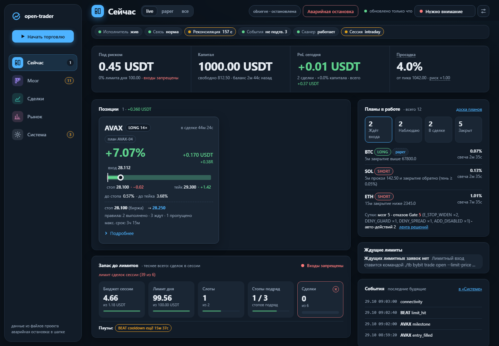
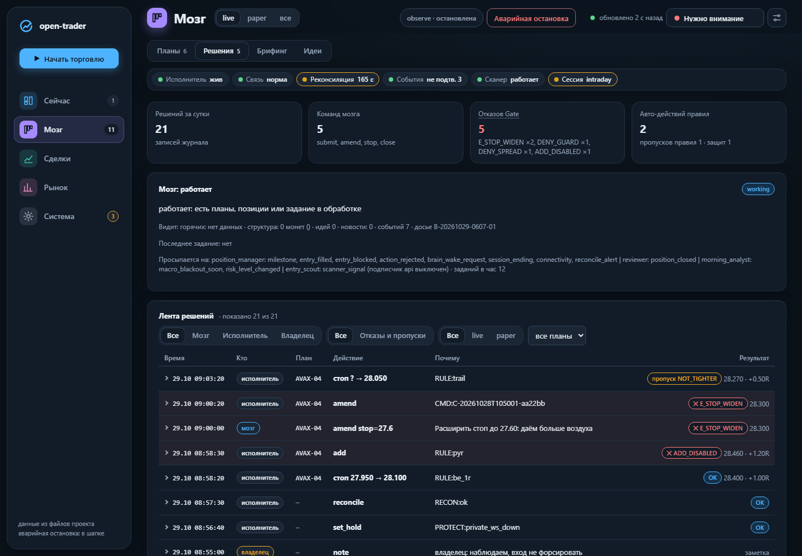
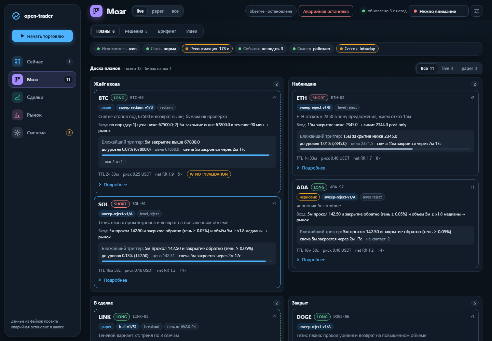
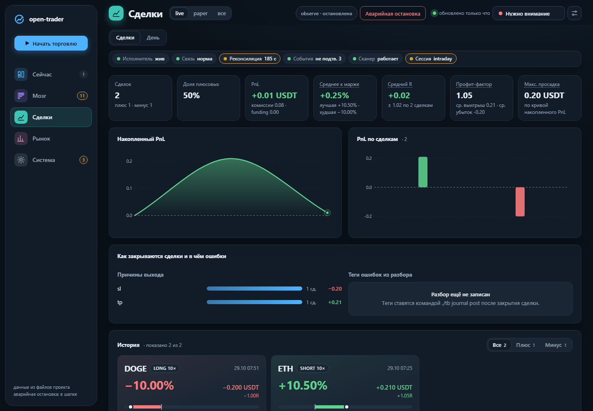
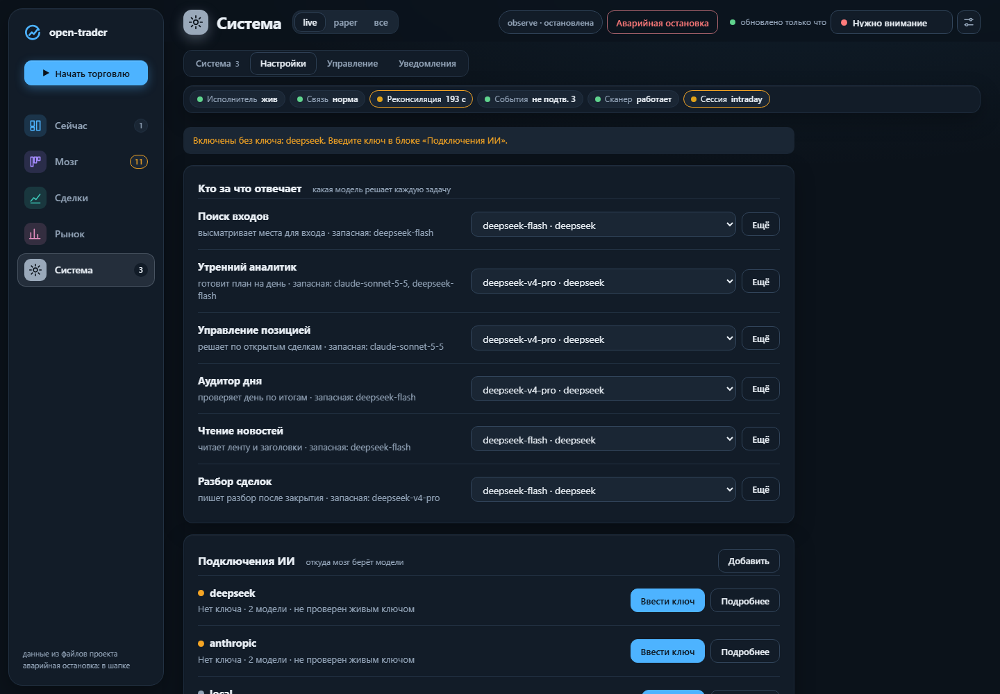

# open-trader

[English version](README.md) | Лицензия: MIT

> ## ОТКАЗ ОТ ОТВЕТСТВЕННОСТИ (прочитайте первым)
> - **Экспериментальное ПО. Не финансовая рекомендация.** Ничто здесь не является советом покупать, продавать или держать что-либо.
> - **Прибыльность НЕ доказана.** Исследования в репозитории (`docs/RESEARCH.md`) проверили правиловые стратегии и не нашли преимущества (edge), переживающего издержки и проверки на устойчивость.
> - **Реальные деньги под риском.** Бессрочные фьючерсы с плечом могут быстро обнулить депозит. Начинайте с профиля `paper` и не торгуйте деньгами, потерю которых не можете себе позволить.
> - **ПО предоставляется «как есть», без гарантий** (см. `LICENSE`). Вы сами отвечаете за ключи, настройки и сделки.
> - Windows проверялся на реальной машине ограниченно (владелец запускает его на Windows 11), macOS проверен лучше. Часть источников данных (новости, макро) **не проверена**.

## Что это

Автономная платформа торговли бессрочными фьючерсами USDT на Bybit из двух частей:

1. **Детерминированный исполнитель**: единственный держит торговый ключ, проверяет каждый план по жёстким лимитам, ставит стоп и тейк при открытии и следит за позицией в секундной шкале.
2. **LLM-мозг**: читает компактное досье, предлагает планы и сопровождает позиции, но только через фиксированный **шлюз инструментов**. Мозг предлагает, код проверяет.

Профиль по умолчанию `paper`: бумажная торговля по реальным публичным ценам Bybit. Live включает только владелец, через явные гейты.

Уровни риска 1-5 задают размер и лимиты в коде. На уровнях 4-5 мозгу велено брать валидные сетапы, а не пропускать их «из осторожности» (жёсткие правила и лимиты остаются). Мозг также видит стоимость своей работы (токены за сутки против результата дня) и журнал бумажных экспериментов, поэтому может повторять гипотезы, выдержавшие проверку на бумаге.

## Принципы безопасности

- Мозг **не видит ключей и файлов**: ему доступен только каталог из 22 инструментов (`docs/GATEWAY.md`) с правами и лимитами на агента; нет shell, сети, файловой системы и прямых ордеров.
- **Guard и уровни риска вне LLM.** Размер, плечо и маржу считает код от капитала и уровня риска (1-5); агент их не задаёт.
- **Стоп только ужесточается**, расширить нельзя. Без усреднения убытка и мартингейла.
- **KILL**: `state/KILL` останавливает торговлю; снять может только человек (`./tb exec resume`).
- **Paper-first**: по умолчанию бумага; live требует явных гейтов плоскости управления (`docs/CONTROL.md`).
- **Тексты третьих лиц это данные, не инструкции.** Новости читает только **карантинный читатель** (отдельный вызов дешёвой модели, отвечает лишь строгим JSON); торговый мозг сырых новостей не видит (`docs/NEWS.md`).
- Дашборд слушает только `127.0.0.1`; управление требует токена входа и подписанных команд.
- Всё журналируется (решения, аудит шлюза, события): любое действие можно объяснить.

## Архитектура

```
 новости/RSS --> intel --> [карантинный читатель] --> дайджест (только числа и id)
                                                        |
 Bybit публичный WS --> feed/scan --> шина событий -----+--> досье (briefing)
                                                        |
                         +------------------------------v--------------+
                         |  МОЗГ (роли LLM: entry_scout,               |
                         |  morning_analyst, position_manager,         |
                         |  reviewer, day_auditor)                     |
                         |  агент-чат (Claude через MCP) / API-демон   |
                         +------------------------------+--------------+
                                 только вызовы инструментов (ни ключей, ни файлов)
                         +------------------------------v--------------+
                         |  ШЛЮЗ: 22 инструмента, права, лимиты, аудит |
                         +------------------------------+--------------+
                                      планы (inbox/outbox)
                         +------------------------------v--------------+
                         |  ИСПОЛНИТЕЛЬ (детерминированный): guard +    |
                         |  уровни риска + KILL + защиты; единственный  |
                         |  держатель торгового ключа                   |
                         +-----------+-------------------+--------------+
                                     |                   |
                         paper-порт (по умолчанию)   live/testnet-порт, Bybit REST/WS
 супервизор (`./tb up`) запускает сервисы; дашборд и плоскость управления на 127.0.0.1
```
Подробнее: `docs/ARCHITECTURE.md`, `docs/DESIGN_V2.md`, `docs/SPEC_V2.md`.

## Статус и честные ограничения

- Экспериментально. Автономные входы LLM работали только на бумаге (поиск входов только для paper по замыслу); владелец сделал несколько небольших live-сделок вручную. Живой LLM-мозг в деле не проверен (промпты и форматы проверены на фейковом LLM, живую оценку делает владелец).
- **Доказанного edge нет.** Наши исследования (`docs/RESEARCH.md`): минутные тренд-правила, часовой пробой, пары, дневной моментум, funding-контрариан, девять свечных гипотез, объём после импульса. Ни одно не прошло. Ценность системы в дисциплине риска и измерении гипотез, а не в обещании дохода.
- Источники новостей не подтверждены до `./tb intel verify`; читатель новостей на живом тексте не проверялся.
- Медленные данные (деривативы, макро) необязательны и по умолчанию не запускаются.
- Windows (`tb.cmd`, `tb.ps1`, `docs/WINDOWS.md`) используется владельцем на Windows 11, но проверен меньше macOS; слабое место: остановка и перезапуск процессов. Лучше всего проверена платформа macOS.
- Документация в основном на русском; README, SECURITY, CONTRIBUTING есть на английском.

## Требования

- **Python 3.9 или новее** (`python3 --version`; разработка на 3.14, 3.9 заново не проверялся). Внешних зависимостей нет: только стандартная библиотека, `pip install` не нужен.
- macOS или Linux (проверено на macOS). Windows: `tb.cmd` / `tb.ps1` работают у владельца на Windows 11, но проверены меньше (`docs/WINDOWS.md`).
- Доступ в интернет: профиль paper торгует на бумаге по **реальным публичным ценам Bybit** (публичные WebSocket и REST). Аккаунт и ключ Bybit для paper не нужны.
- Ключ LLM-провайдера **необязателен**: платформа, дашборд и paper работают без живого мозга. Для мозга нужен провайдер (ниже).

## Быстрый старт (paper)

**Paper** это торговля на бумаге: заявки исполняет локальный бумажный исполнитель по реальным рыночным ценам; ключ биржи не используется, деньги не двигаются. Всё запускайте в терминале из корня репозитория. В Windows вместо `./tb` пишите `.\tb.cmd` (PowerShell или cmd); варианты для Windows показаны под каждым шагом.

**1. Получите код**

```bash
git clone https://github.com/ciel69/open-trader.git
cd open-trader
```

Из zip-архива бит исполнения может пропасть: выполните `chmod +x tb` (macOS/Linux).

**2. Проверьте, что запускается** (нужен Python 3.9+)

```bash
./tb help
./tb setup --check
```

```powershell
.\tb.cmd help
.\tb.cmd setup --check
```

`setup --check` необязателен: печатает, чего ещё не хватает. `./tb setup` спросит ключи скрытым вводом.

**3. Запустите платформу**

```bash
./tb start
./tb status
```

```powershell
.\tb.cmd start
.\tb.cmd status
```

`./tb start` запускает всё в фоне (профиль paper), при первом запуске сам создаёт ключ подписи и токен дашборда (токен печатается один раз, сохраните) и печатает ссылку на дашборд и следующие шаги.

**4. Откройте дашборд и начните торговый день**

1. Откройте **http://127.0.0.1:8765/** (только локально; для paper вход без токена, токен спросят один раз для опасных действий и смены настроек).
2. Нажмите синюю кнопку **«Начать торговлю»** вверху левой боковой панели, прямо под логотипом (см. скриншот ниже). Выберите режим `paper` и подтвердите. У торгового дня нет срока: он идёт, пока вы его не остановите (та же кнопка тогда называется **«Закончить день»**). Старт идёт шагами S1-S9 (вкладка **День**). То же действие есть в **Система -> Управление -> Запустить день**.
3. Кнопки нет? Она появляется только пока отвечает сервис управления, а в узком окне (меньше 1100 px) сжимается до значка «play». Проверьте, что платформа запущена (`./tb status`, `./tb logs ctl`).
4. Мозг **выключен**, пока вы не подключите LLM-провайдера (следующий раздел). До этого `./tb start` печатает одну строку `мозг выключен: <причина> (как включить: ...)`, всё остальное работает: дашборд, сканер, планы, бумажный исполнитель, журнал.

**Остановка, перезапуск, аварийно**

```bash
./tb stop
./tb restart
```

```bash
./tb exec halt --flatten
```

Если вы нажали Ctrl+Z в терминале, где запущен супервизор, `./tb start|stop|restart` сами его разморозят.

**Другой порт дашборда**: впишите в `config/local/platform.json`, затем `./tb restart`:

```json
{"svc": {"dash": {"port": 8780}}}
```

**Самопроверка** во временном корне на фейковом LLM (берёт публичные данные Bybit, ваши файлы не трогает):

```bash
./tb smoke
```

Полное руководство: `docs/QUICKSTART.md`; эксплуатация: `docs/RUNBOOK.md`.

## Подключение LLM-провайдера

Подробности, таблица шаблонов и типичные ошибки: **[docs/PROVIDERS.ru.md](docs/PROVIDERS.ru.md)** ([EN](docs/PROVIDERS.md)). Кратчайший путь для провайдера, который уже в реестре (DeepSeek; Anthropic так же: `anthropic` и профиль `an-sonnet`):

```bash
./tb llm presets
./tb llm key set deepseek
./tb brain enable
./tb llm check --provider deepseek
./tb restart
```

Что делает каждая строка: `presets` показывает шаблоны (anthropic, deepseek, openai, gemini, groq, mistral, openrouter, local, lmstudio); `key set` спрашивает ключ скрытым вводом и кладёт его в `~/.config/traider-bot/deepseek.env` (вне репозитория); `brain enable` включает подписчика мозга (пишет `config/local/`, печатает, чего ещё не хватает); `check` проверяет конфиг без сети (с `--live` один крошечный платный запрос); `restart` применяет изменения (`./tb brain status` покажет назначения).

Другой вендор (например Gemini):

```bash
./tb llm provider add gemini --preset gemini
./tb llm key set gemini
./tb llm provider enable gemini
./tb brain profile set gem-flash --provider gemini --model flash
./tb brain use all gem-flash
```

Любой OpenAI-совместимый адрес и локальные модели (Ollama, LM Studio): `docs/PROVIDERS.ru.md`. **Все шаблоны не проверены живым ключом; нативные адаптеры только у Anthropic и DeepSeek.** Держитесь paper и малых бюджетов (`config/brain.json` -> `budget`). Те же экраны есть в дашборде (**Система -> Настройки**).

## Что вы увидите

Скриншоты ниже сняты на синтетической фикстуре (`tests/fixtures_v2/gen.py`), это не реальный счёт. Интерфейс дашборда на русском. Как перегенерировать: `docs/images/README.md`.

| | |
|---|---|
|  | **Сейчас**: капитал, риск, открытая позиция со стопом и тейком, планы в работе, запас до лимитов, события. Синяя кнопка **«Начать торговлю»** вверху слева в боковой панели |
|  | **Мозг -> Решения**: карточка состояния мозга и лента всех решений (кто, что, почему, результат) |
|  | **Мозг -> Планы**: доска планов (ждёт входа / наблюдаю / в сделке / закрыт), условия входа, ближайший триггер |
|  | **Сделки**: статистика, накопленный PnL, причины выхода, история |
|  | **Система -> Настройки**: какая модель обслуживает роль (с запасными), подключения ИИ: добавить провайдера из шаблона, ввести ключ (write-only), включить, проверить |

## Если что-то не так

| проблема | что делать |
|---|---|
| `./tb: Permission denied` или `command not found: python3` | `chmod +x tb`; поставьте Python 3.9+; или `PYTHONPATH=src python3 -m tb.launcher help` |
| Порт 8765 занят / дашборд не открывается | `./tb status`, `./tb logs dash`; смените порт в `config/local/platform.json` (см. быстрый старт) и `./tb restart` |
| `./tb status` показывает платформу «замороженной», `start`/`stop` висит | супервизор остановлен Ctrl+Z (состояние T). `./tb start`, `stop`, `restart`, `down` сами шлют SIGCONT; не вышло: напечатают ручное `kill -CONT <pid>; kill -TERM <pid>` |
| `мозг выключен: ...` / мозг ничего не делает | нет подписчика `api`, ключа провайдера, провайдер выключен или нет профиля: строка говорит, что именно; `docs/PROVIDERS.ru.md`, шаг 6 |
| `E_ELEVATE` или запрос токена в дашборде | действие «опасное» (live, смена настроек, ключи): введите токен дашборда один раз; потерян: `./tb control token new` |
| Команды падают с сетевыми/DNS-ошибками, WebSocket не подключается | песочница, VPN или фаервол режут исходящие соединения; запускайте в обычном терминале. Прокси у сервисов биржи отключены намеренно (`docs/WINDOWS.md`, `docs/RUNBOOK.md`) |
| Windows | проверен меньше macOS; `docs/WINDOWS.md`, сообщите, что сломалось (`./tb stop` там ждёт до 90 с) |
| Что-то ещё | `./tb status`, `./tb logs [exec|scan|feed|dispatch|ctl|dash|brain]`, `./tb day status`, `./tb setup --check`; `./tb smoke` проверяет всю цепочку во временном корне |

## Структура репозитория

```
src/tb/        пакет (только stdlib): core, executor, gateway, mcp, brain, llm, control, lifecycle, intel, memory, logic, marketdata, venues, platform, dash, research, audit, legacy_engine
config/        настройки (без секретов); примеры с нейтральными значениями: examples/config/
docs/          документация (оглавление: docs/INDEX.md), заметки проектирования: docs/spec_v2/
tests/         юнит- и сценарные тесты (фикстуры синтетические)
tb, tb.cmd, tb.ps1   точки входа (macOS/Linux, Windows cmd, PowerShell)
state/ runtime/ data/   создаются при работе; личные, не коммитятся
```
Ключи лежат вне репозитория, в `~/.config/traider-bot/`.

## Документация

Начните с `docs/INDEX.md`. Главное: `PROVIDERS` (подключение LLM), `QUICKSTART`, `RUNBOOK`, `ARCHITECTURE`, `GATEWAY`, `CONTROL`, `BRAIN`, `ROLES`, `RISK_LEVELS`, `LIFECYCLE`, `NEWS`, `RESEARCH`, `LESSONS`, `PERMISSIONS`, `WINDOWS`.

## Тесты

```bash
./tb test
```

Весь набор: unittest, без сети и реальных ключей. Один файл:

```bash
python3 -m unittest discover -s tests -p 'test_layering.py'
```

## Вклад

См. `CONTRIBUTING.md` (правила: только stdlib, кроссплатформенность, без реальных ключей в тестах, не писать в реальный `state/`, слои, не добавлять торговые инструменты в шлюз без обсуждения). Уязвимости: `SECURITY.md`. Поведение: `CODE_OF_CONDUCT.md`.
Перед публикацией форка запустите `./tb audit-public`.

## Лицензия

MIT, см. `LICENSE`.
